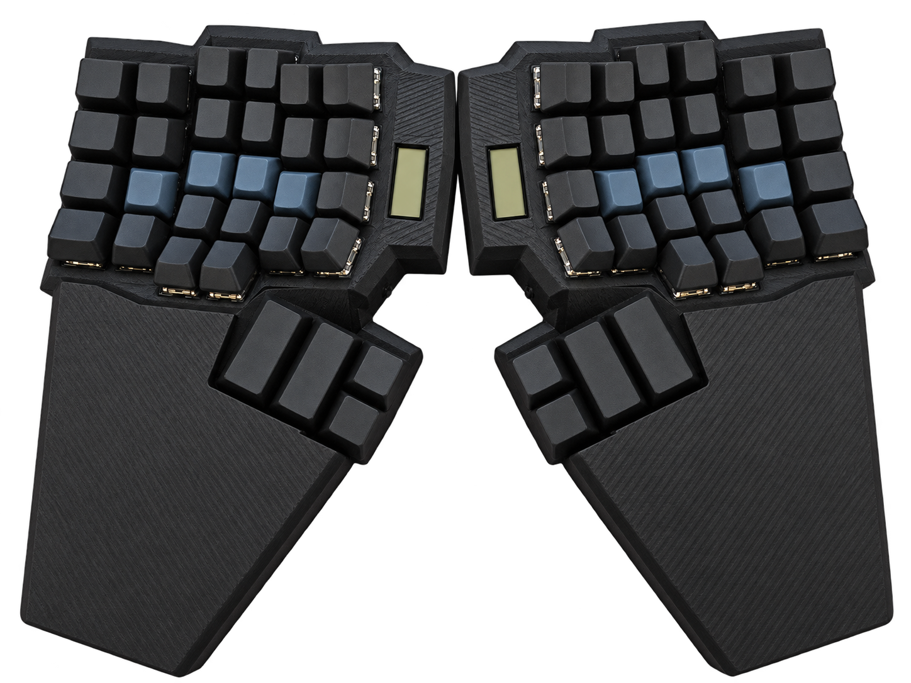

<!-- _class: title hero -->

<!--
  Титульна сторінка: фото клавіатури на весь слайд, текст по центру поверх нього.

  `_class: title hero` — окремим HTML-коментарем із `_` (scope лише цієї сторінки),
  а не у front-matter: front-matter першого файлу діє на весь deck, бо
  build.mjs зливає ці файли в один документ.

  `![bg cover]` без `right:45%` = full-bleed: Marpit рендерить картинку як
  окремий шар ПІД вмістом слайда, тому `.hero` у theme/keeb.css не має власного
  фону, а затемнення під текстом робить pseudo-element `::before` (м'яке
  радіальне, щоб клавіатура залишалася видно).

  Фото — docs/assets/index.png (світлини збірки без пробілів в імені).
  Для фото, яке треба обрізати під рамку, — `cover`, для схеми — `contain`.

  Експорт вимагає `--allow-local-files`, інакше Marp блокує локальні
  зображення (це вже робить docs/build.mjs).
-->

# Безпровідна Ергономічна Спліт Клавіатура

Доповідач: **Єрмаков Михайло Вікторович**

