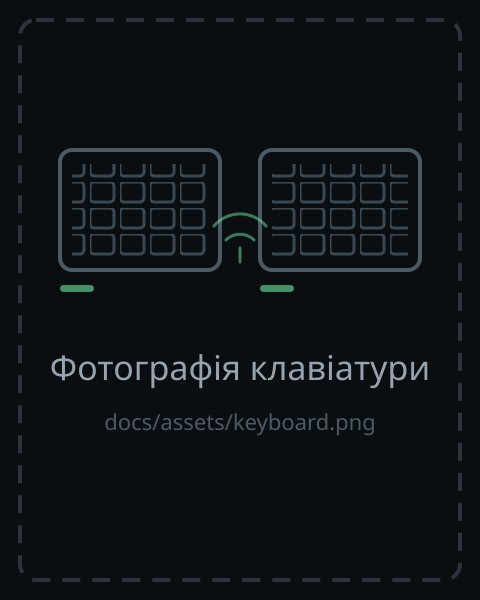

<!-- _class: title -->

<!--
  Титульна сторінка.

  Макет: зліва заголовок і підзаголовок, справа — фото клавіатури
  (split background `right:45%`, клас `title` з теми `keeb`).

  `_class: title` — окремим HTML-коментарем із `_` (scope лише цієї
  сторінки) і не у front-matter: front-matter першого файлу діє на весь
  deck, бо build.mjs щедрить ці файли в один документ.

  Заглушка: docs/assets/keyboard-placeholder.svg — співвідношення 480:600
  збігається з правою половиною слайда 16:9, тому `contain` заповнює її точно.

  Реальне фото:
    1. покласти зображення в docs/assets/keyboard.png
    2. замінити шлях нижче на assets/keyboard.png
    3. для фото, яке треба обрізати, — `cover` замість `contain`

  Дзеркальний макет (фото зліва, текст справа):
    `` + клас `title flip`

  Експорт вимагає `--allow-local-files`, інакше Marp блокує локальні
  зображення (це вже робить docs/build.mjs).
-->

# Безпровідна Ергономічна Спліт Клавіатура

Доповідач: **Єрмаков Михайло Вікторович**

