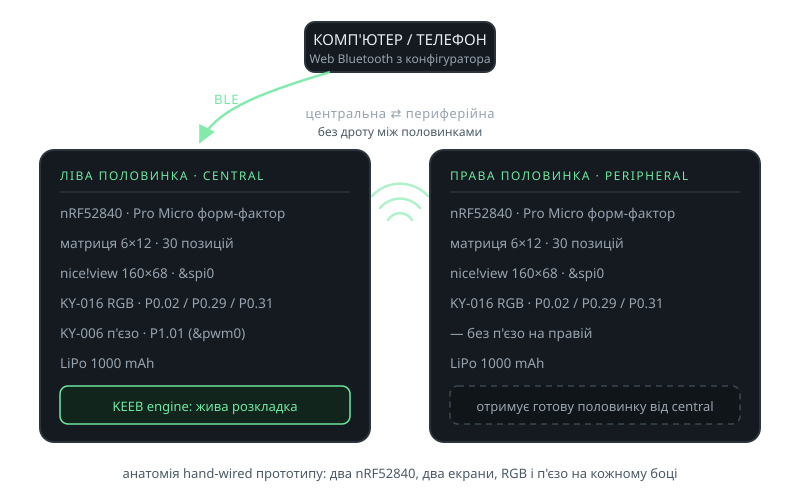

<!-- _class: visual -->

# Ідея: дві половинки, жодного дроту

<figure>

<figcaption>Hand-wired прототип: що де сидить і як половинки спілкуються</figcaption>
</figure>

<h3>Ніяких проводів</h3>

Між половинками і з комп'ютером — лише <strong>BLE</strong>

<h3>Налаштування під себе</h3>

Розкладка, шари i поведінки змінюються <strong>без перепрошивки</strong> — через власний канал.

<h3>Зручність</h3>

Спліт тримає кисті й лікті рівно, активно використовуються великі пальці; половинки ставляться так, як зручно саме вам.

<h3>Час роботи</h3>

Глибокий сон контролера, опитування матриці замість постійного сканування, світлові ефекти тільки на окремі події.

