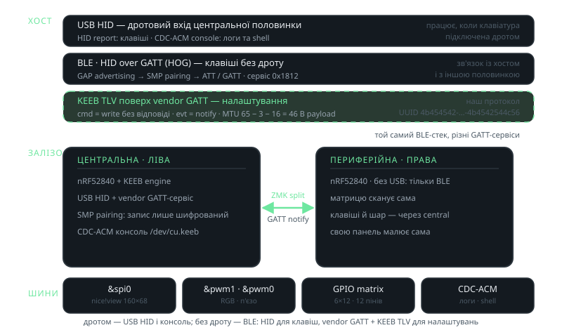

<!-- _class: visual -->

# Протоколи: чим це говорить

<figure>

<figcaption>той самий BLE-стек, різні GATT-сервіси; дріт лишається для налагодження</figcaption>
</figure>

<h3>Права половинка — без дроту</h3>

<code>CONFIG_ZMK_USB=n</code>: вона бачить лише центральну. USB HID і консоль — на лівій.

<h3>Не протоколи, але зайнято</h3>

Матриця — GPIO scan, екран — <code>&amp;spi0</code>, RGB і п'єзо — <code>&amp;pwm1</code> / <code>&amp;pwm0</code>: 18 GPIO Pro Micro майже всі задіяні.

