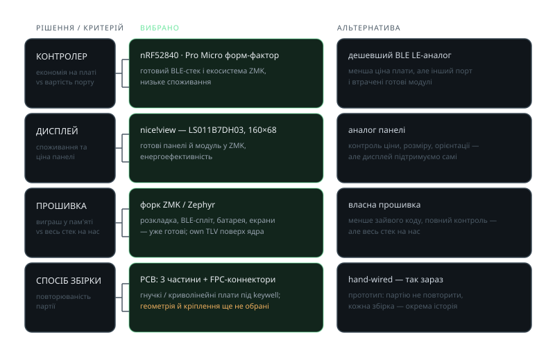

<!-- _class: visual -->

# Ключові рішення

<figure>

<figcaption>обранi рішення і чому</figcaption>
</figure>

<h3>Спільний знаменник</h3>

Кожне рішення — про <strong>повторюваність партії</strong>.

<h3>Бізнес-модель</h3>

Дохід — продаж <strong>попередньо зібраних плат</strong> та аксесуарів: корпус, екрани, світчі, кейкапи, батареї.

<h3>Де кастомізація</h3>

У розкладці й налаштуваннях, а не в пайці: клієнт отримує готовий пристрій.

