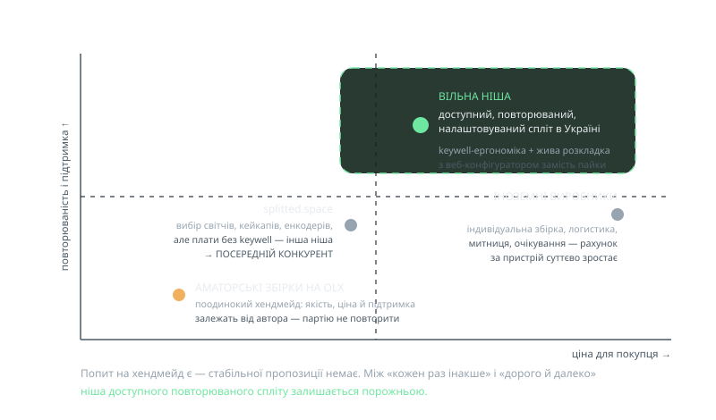

<!-- _class: visual -->

# Ринок: з ким ми поруч

<figure>

<figcaption>вісь X — ціна, вісь Y — якість і підтримка</figcaption>
</figure>

<h3><a href="https://splitted.space/">splitted.space</a></h3>

Єдиний відомий український виробник: вибір світчів, кейкапів, енкодерів — але <strong>плати без keywell</strong>, інша ергономічна ніша.

<h3>OLX</h3>

Поодинокий хендмейд: попит є, стабільної пропозиції немає.

<h3>Іноземні виробники</h3>

Індивідуальна збірка + логистика, митниця, очікування: рахунок за пристрій суттєво зростає.

<h3>Висновок</h3>

Ніша доступного, повторюваного й налаштовуваного спліту в Україні <strong>залишається вільною</strong>.

