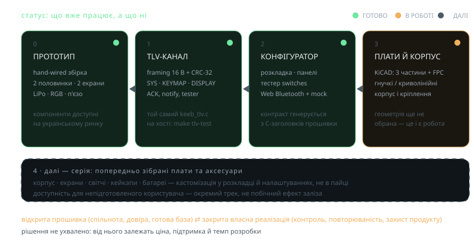

<!-- _class: visual -->

# Статус проєкту

<figure>

<figcaption>Потенційний roadmap</figcaption>
</figure>

<h3>Готово</h3>

Повністю зібраний <strong>hand-wired прототип</strong> з компонентів, доступних на українському ринку: дві половинки з екранами, зв'язком і живленням.

<h3>Треба зробити</h3>

Вдосконалення прошивки, доступність для непідготовленого користувача, проєктування <strong>гнучких і криволінейних плат</strong> матриці, аналіз альтернатив серед SMD компонентів.

<h3>Ліцензування</h3>

Два шляхи: <strong>відкрита прошивка</strong> (спільнота, довіра, готова база) або <strong>закрита власна реалізація</strong> (контроль, повторюваність, захист продукту).

