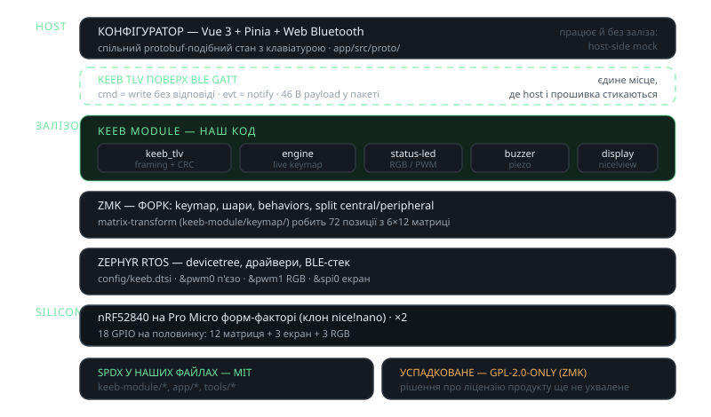

<!-- _class: visual -->

# Залежність: ZMK / Zephyr RTOS

<figure>

<figcaption>у репозиторії тільки наш код — модулі, конфіг і застосунок</figcaption>
</figure>

<h3>Out-of-the-box</h3>

BLE-спліт central/peripheral, keymap / layers / hold-tap, матриця з matrix-transform, драйвер nice!view, глибокий сон.

<h3>Ціна</h3>

Зміни upstream потенційно потрапляють у нашу збірку; готовий код коштує флешу й RAM на nRF52840; наші модулі чутливі до внутрішнього API ZMK.

---

<!-- _class: visual -->

# Ліцензування: що можна й що треба зберегти

<b>ZMK</b> — MIT
<b>Zephyr</b> — Apache-2.0
<b>Радіо</b> — відкритий BLE-стек Zephyr, не пропрієтарний стек Nordic
<b>Наша ліцензія</b> залежить від бізнес-рішень

<h3>MIT (ZMK)</h3>

Використовувати, змінювати і продавати, зокрема із закритим власним кодом. Умова — текст ліцензії та копірайт у поширюваних копіях.

<h3>Apache-2.0 (Zephyr)</h3>

Закритий похідний продукт дозволений, плюс явна патентна ліцензія. Умова — копія ліцензії, NOTICE і позначка внесених змін.

Обидві ліцензії пермісивні: юридично чистий як і відкритий, так і закритий похідний продукт.

