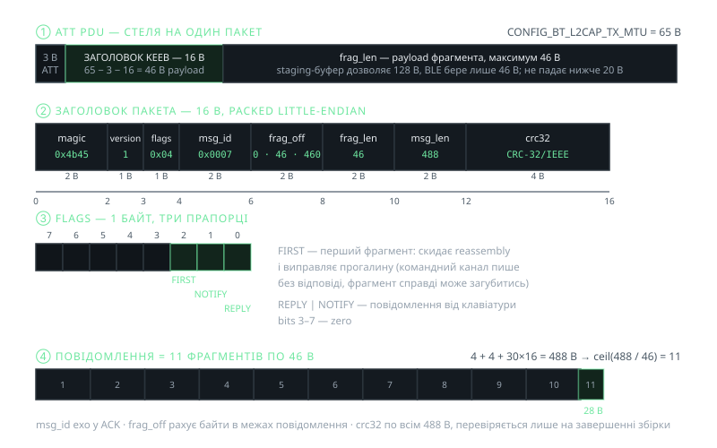
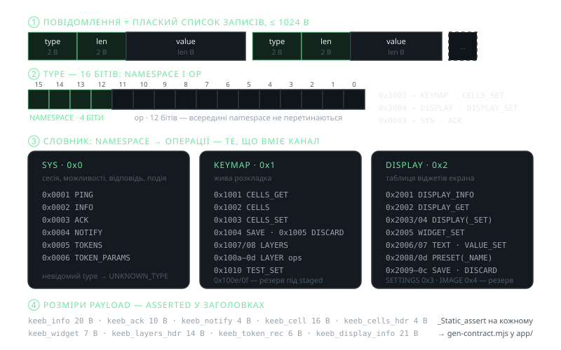
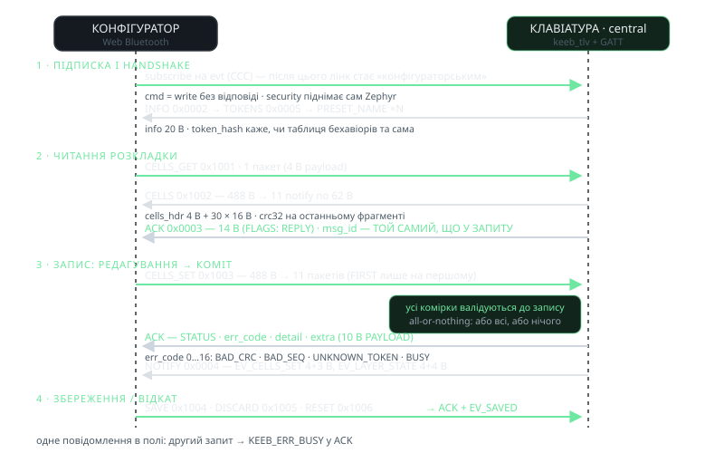
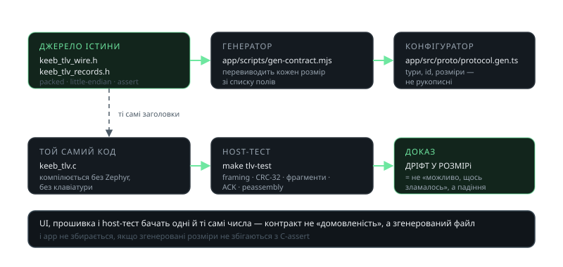

<!-- _class: visual -->

# Жива розкладка: пакет KEEB TLV

<figure>

<figcaption>зліва — скільки байтів залишається після ATT; нижче — як 488-байтове повідомлення стає 11 пакетами</figcaption>
</figure>

<h3>Арифметика MTU</h3>

MTU 65 − 3 (ATT) − 16 (заголовок) = <strong>46 B payload</strong>. Тому присутня фрагментація.

<h3>Запас у рушії</h3>

128B < Фрагмент < 20B.

<h3>Навіщо прапорець FIRST</h3>

Канал пише <em>без відповіді</em>, тож фрагмент справді може загубитись: FIRST скидає збірку й виправляє прогалину.

<h3>CRC — наприкінці</h3>

crc32 рахується по всіх 488B і перевіряється на завершенні: збитий фрагмент видно не в пакеті, а в кінці збірки.

---

<!-- _class: visual -->

# Повідомлення й словник операцій

<figure>

<figcaption>той самий канал читає і розкладку, і панелі екрана — відрізняється лише namespace</figcaption>
</figure>

<h3>Канал власний</h3>

Без залежності від ZMK Studio: використовуємо тільки ядро динамічної розкладки ZMK, а протокол — свій.

<h3>Невідомий type</h3>

Канал не вгадує операцію: <code>KEEB_ERR_UNKNOWN_TYPE</code> у ACK. Імена зарезервовані (SETTINGS, IMAGE, APPLY_COMMIT/CANCEL), щоб host не вигадав конфлікт.

<h3>Токени замість назв</h3>

Host не називає behavior — він посилається на index із devicetree. <code>token_hash</code> каже, чи таблиця конфігуратора ще збігається з прошивкою.

---

<!-- _class: visual -->

# Обмін: запит → фрагменти → ACK

<figure>

<figcaption>одна й та сама рамка в обидва боки: write без відповіді вгору, notify вниз, ACK окремо</figcaption>
</figure>

<h3>Central — єдині ворота</h3>

Рушій live-змів збирається лише на central: ZMK розв'язує binding там і надсилає готову половинку периферійній.

<h3>Одне повідомлення в полі</h3>

Другий запит під час першого отримує <code>KEEB_ERR_BUSY</code> у ACK, а не «перемалювання» на півслові.

<h3>Все або нічого</h3>

<code>CELLS_SET</code>: спершу валідація кожної комірки, потім запис. <code>err_code</code> 0…16 каже, чому не зайшло.

<h3>Шифрування не наша робота</h3>

Pairing стартує, коли конфігуратор підписується на notify; write без bond Zephyr відбиває як Insufficient Authentication.

---

<!-- _class: visual -->

# Контракти: чому дві сторони не роз'їжджаються

<figure>

<figcaption>контракт — не домовленість між двома розробниками, а згенерований файл</figcaption>
</figure>

<h3>Той самий код</h3>

<code>keeb_tlv.c</code> компілюється без Zephyr: <code>make tlv-test</code> гоняє framing, CRC, фрагменти й ACK на хості.

<h3>Розміри — assert</h3>

Кожен запис має <code>_Static_assert</code> на розмір; генератор перевиводить його зі списку полів і мовчить не може.

<h3>Куди дивитись при зміні</h3>

Змінив структуру — стоять обидва білды. Це дешевше, ніж «мови не збігаються, на клавіатурі щось зламалось».

