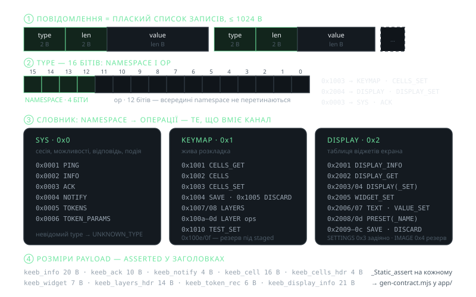
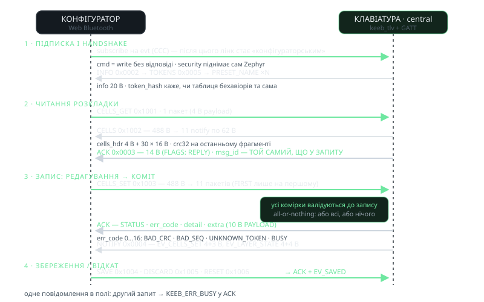

<!-- _class: visual -->

# Повідомлення й словник операцій

<figure>

<figcaption>той самий канал читає і розкладку, і панелі екрана — відрізняється лише namespace</figcaption>
</figure>

<h3>Канал власний</h3>

Без залежності від ZMK Studio: використовуємо тільки ядро динамічної розкладки ZMK, а протокол — свій.

<h3>Невідомий type</h3>

Канал не вгадує операцію: <code>KEEB_ERR_UNKNOWN_TYPE</code> у ACK. Імена зарезервовані (SETTINGS, IMAGE, APPLY_COMMIT/CANCEL), щоб host не вигадав конфлікт.

<h3>Токени замість назв</h3>

Host не називає behavior — він посилається на index із devicetree. <code>token_hash</code> каже, чи таблиця конфігуратора ще збігається з прошивкою.

---
<!-- _class: visual -->

# Обмін: запит → фрагменти → ACK

<figure>

<figcaption>одна й та сама рамка в обидва боки: write без відповіді вгору, notify вниз, ACK окремо</figcaption>
</figure>

<h3>Central — єдині ворота</h3>

Рушій live-змів збирається лише на central: ZMK розв'язує binding там і надсилає готову половинку периферійній.

<h3>Одне повідомлення в полі</h3>

Другий запит під час першого отримує <code>KEEB_ERR_BUSY</code> у ACK, а не «перемалювання» на півслові.

<h3>Все або нічого</h3>

<code>CELLS_SET</code>: спершу валідація кожної комірки, потім запис. <code>err_code</code> 0…16 каже, чому не зайшло.

<h3>Шифрування не наша робота</h3>

Pairing стартує, коли конфігуратор підписується на notify; write без bond Zephyr відбиває як Insufficient Authentication.

