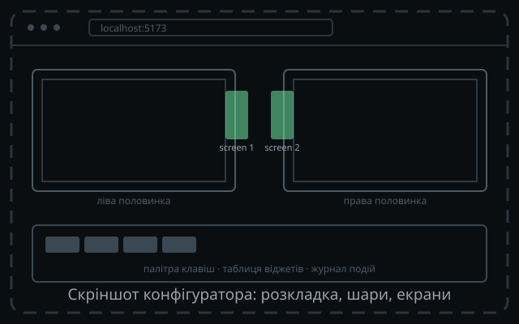

<!-- _class: dense -->

<!--
  Скріншот замість заглушки: покласти docs/assets/webui.png і замінити src нижче.
  Заглушка — assets/webui-screenshot-placeholder.svg (640×400, 16:10).
-->

# Веб-конфігуратор

<h3>Редактор розкладки/шарів</h3>

Mouse-friendly UI: елементи можна налаштувати по кліку

Apply = один <code>CELLS_SET</code>

<h3>Редактор екранів</h3>

Таблиця віджетів і їх налаштування: текст/розмір/розташування.

Межі набору віджетів диктує firmware

<h3>Тестер клавіш</h3>

Індикація активних свічів і keycode: <code>TEST_SET</code>, <code>EV_KEY</code> із позицією.

<strong>Стек:</strong> Vue 3 + Vite + Pinia + TypeScript. Хеш токенів звіряється перед записом.

