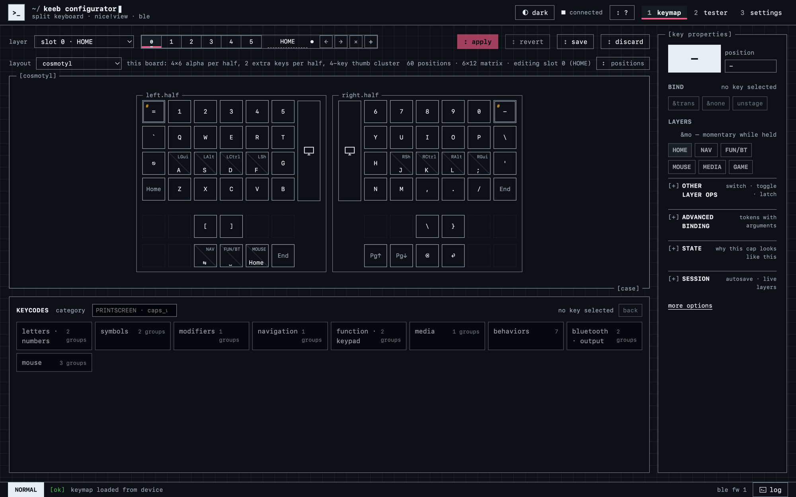
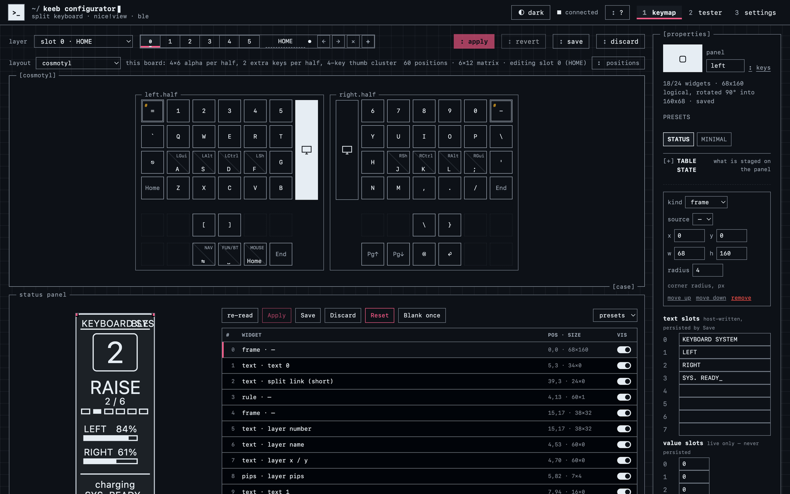
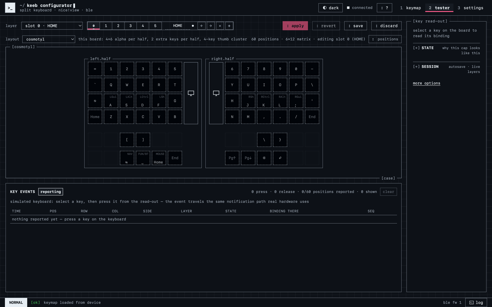

<!-- _class: visual -->

# Веб-конфігуратор: розкладка і шари

<figure class="shot">

<figcaption>реальний застосунок: Vue 3 + Vite + Pinia + TypeScript, 60 позицій, 6×12 матриця</figcaption>
</figure>

<h3>Apply = один запис</h3>

Усі правки живуть у браузері; на клавіатуру летить <strong>один <code>CELLS_SET</code></strong> на шар — а не 60 запитів.

<h3>Хеш токенів</h3>

Звіряється перед записом: behavior, якого немає в image, неможливо призначити.

<h3>Не потребує бекенду</h3>

Комунікація відбувається між браузером юзера і його ж девайсом - достатньо простого веб-серверу для роздачі статичних файлів

---

<!-- _class: visual -->

# Веб-конфігуратор: панелі екрана й тестер

<figure class="shot">

<figcaption>редактор панелі: таблиця віджетів, текст, розмір, розташування</figcaption>
</figure>

<figure class="shot">

<figcaption>тестер: який свіч натиснуто і на якому шарі</figcaption>
</figure>

<h3>Межі диктує firmware</h3>

Набір віджетів і їх геометрію обмежує прошивка: конфігуратор не може намалювати те, що двигун не підтримує.

<h3>Показники ZMK не підробити</h3>

Шар, батарея, лінк, зарядка, під'єднаний пристрій — власність прошивки. Віджет обирає лише <strong>який</strong> з'явиться і <strong>де</strong>.

