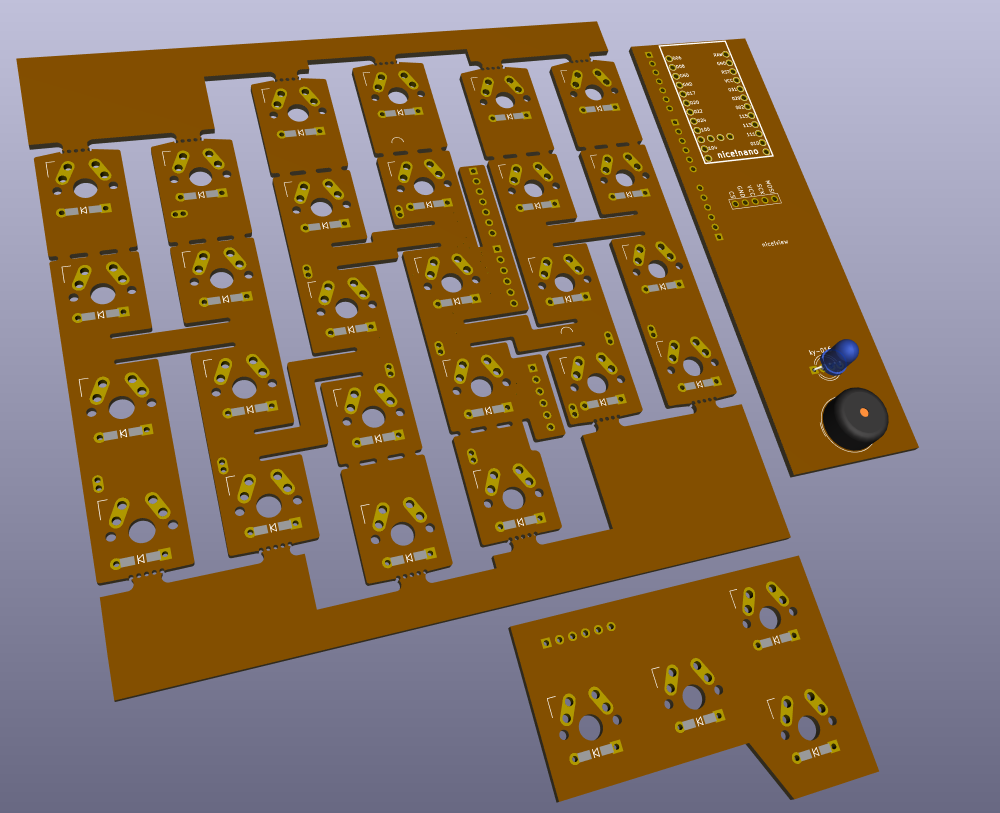
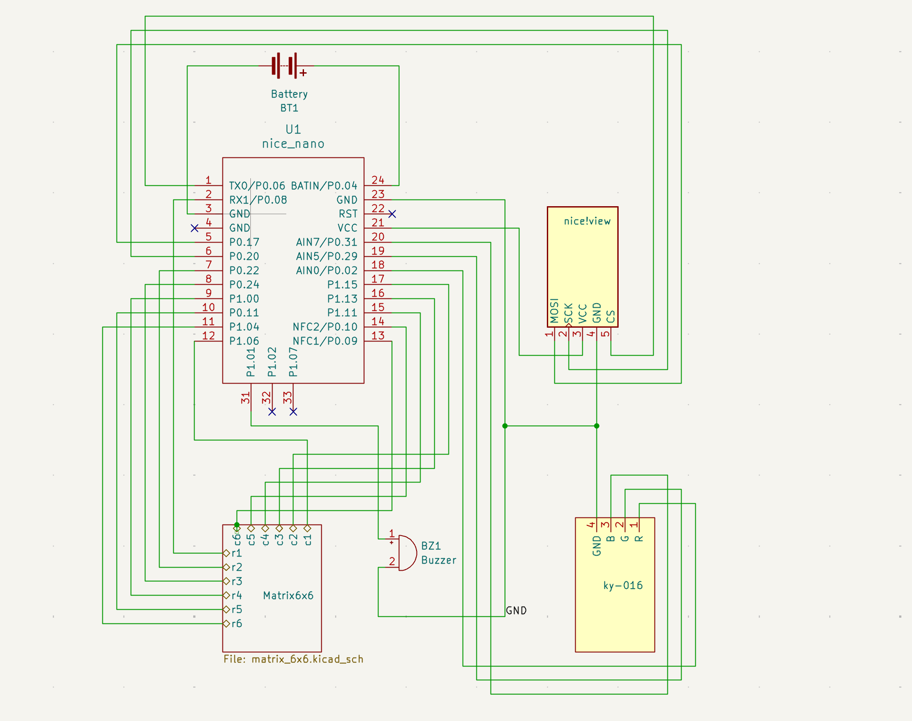
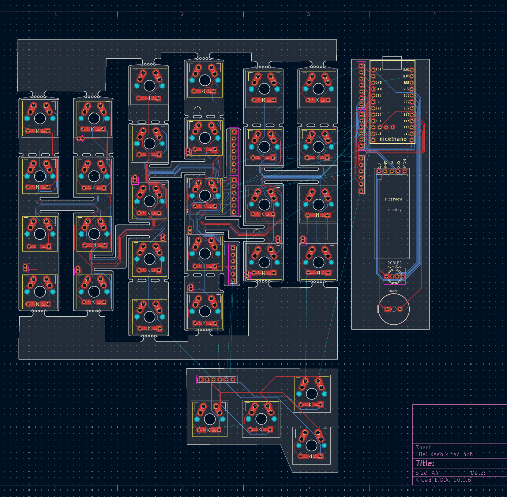

<!-- _class: visual -->

# Плати матриці

<figure class="shot">

<figcaption>3D-рендер плати матриці — те, куди треба рухатись після прототипу</figcaption>
</figure>

<h3>GPIO-бюджет</h3>

12 пінів матриці + 3 екран + 3 RGB: майже всі 18 GPIO Pro Micro вже зайняті.

<h3>KiCAD</h3>

Проєкт має три частини, які з'єднуються <strong>FPC-коннекторами</strong>.

<h3>Геометрія</h3>

Задум — гнучкі чи криволінейні плати під keywell-ергономіку; остаточні форма й кріплення ще не обрані.

<h3>Наразі</h3>

Hand-wired збірка: це прототип, а не повторювана конструкція.

---

<!-- _class: visual -->

# Плати: розведення частин

<figure class="shot">

<figcaption>Schematic</figcaption>
</figure>

<figure class="shot">

<figcaption>PCB</figcaption>
</figure>

<h3>Чому три частини</h3>

Одна плата на половинку + окремий борд під екран і контролер: FPC дає кривизну там, де жорсткий FR-4 її не дає.

<h3>Ще не рішення</h3>

Це робочі варіанти розведення, не фінальна ревізія

