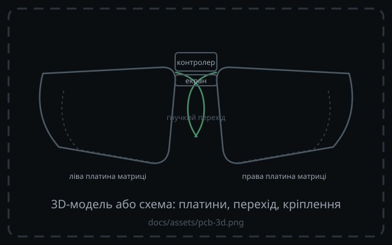

<!-- _class: dense -->

# Плати матриці

<!-- Заглушку замінює docs/assets/pcb-3d.png — 3D-модель або схема плати. -->

<h3>GPIO</h3>

12 пінів матриці + 3 екран + 3 RGB: майже всі 18 GPIO Pro Micro.

<h3>Гнучкість під keywell ергономіку</h3>

Задум: гнучкі чи криволінейні pcb.

<h3>KiCAD </h3>

KiCAD-проєкт має три частини які зʼєднуються FPC-коннекторами

Остаточні геометрія й кріплення ще не обрані.

<strong>Наразі</strong> — hand-wired збірка

