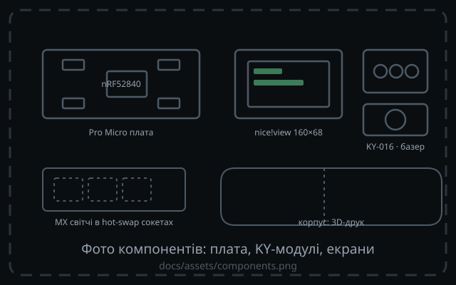

<!-- _class: dense -->

# Компоненти

<!-- Заглушку замінює docs/assets/components.png — фото плати, KY-модулів, екранів. -->

<h3>Контролер</h3>

nRF52840 на Pro Micro-платі (клон nice!nano); 1000 mA/h LiPo батарея для живлення.

<h3>Екрани</h3>

nice!view (LS011B7DH03) 160×68 на <code>&amp;spi0</code> — по одному на половинку.

<h3>Індикація й звук</h3>

KY-016 RGB на P0.02/P0.29/P0.31; buzzer — KY-006 пасивний п'єзо (P1.01).

Тон задає частота PWM, без транзистора.

<h3>Матриця</h3>

MX-світчі в hot-swap сокетах, діоди col→row; корпус — 3D-друк

