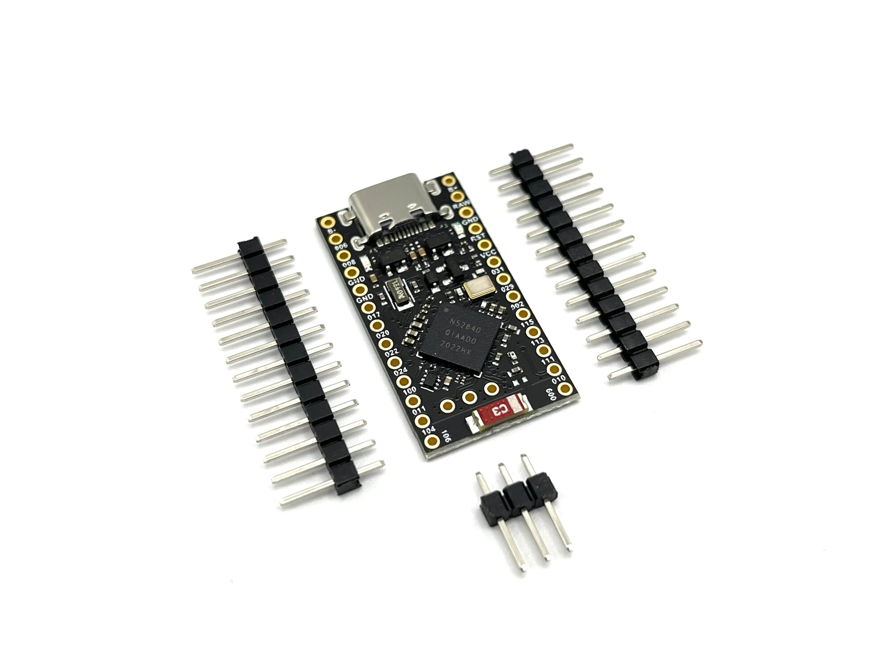
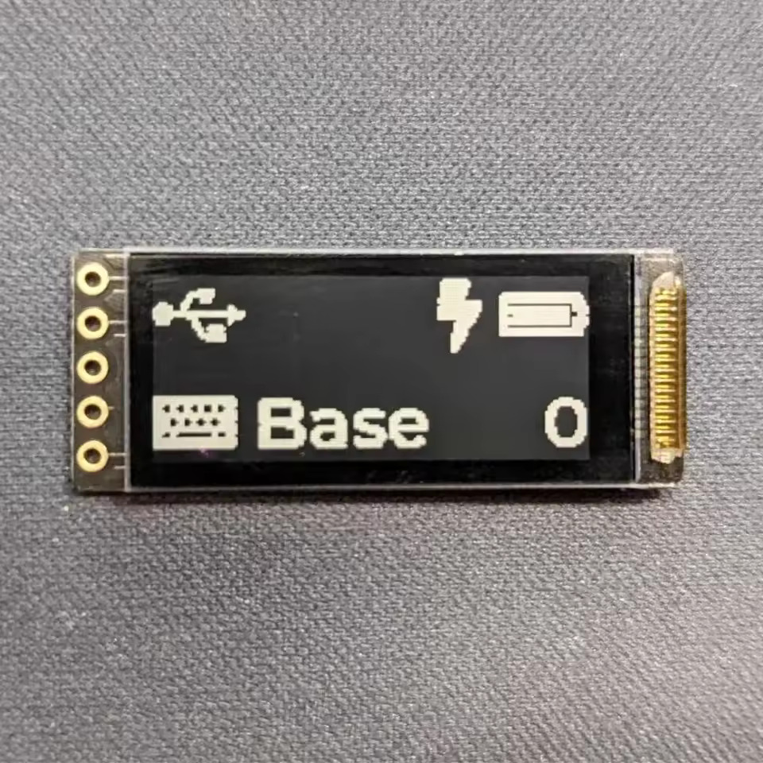
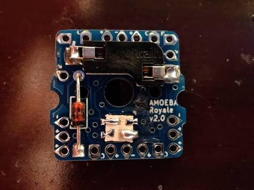
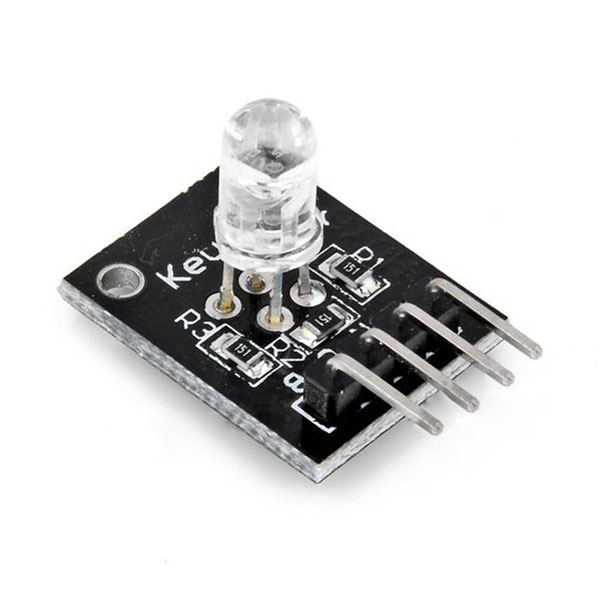
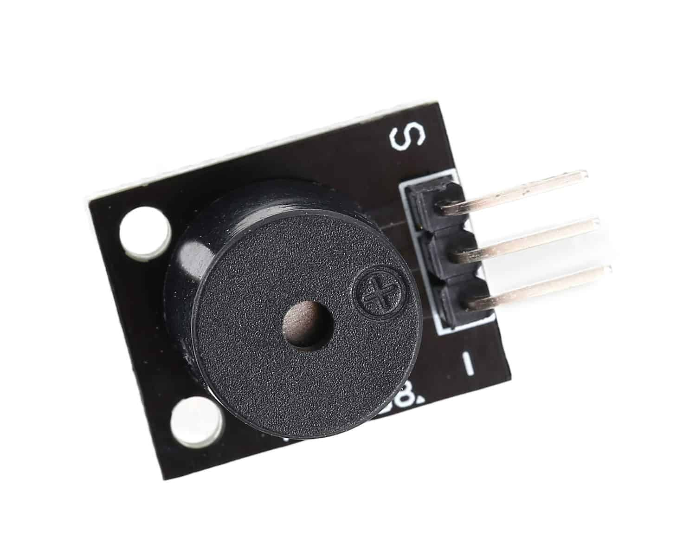

<!-- _class: visual -->

# Компоненти

<figure class="shot">

<figcaption>nRF52840 · Pro Micro форм-фактор</figcaption>
</figure>

<figure class="shot">

<figcaption>nice!view · 160×68</figcaption>
</figure>

<figure class="shot">

<figcaption>Amoeba — сокети MX і діоди матриці (без RGB для економії заряду)</figcaption>
</figure>

<figure class="shot">

<figcaption>KY-016 RGB</figcaption>
</figure>

<figure class="shot">

<figcaption>KY-006 · пасивний п'єзо (HW-508)</figcaption>
</figure>

<h3>Матриця</h3>

60 позицій: MX-світчі в hot-swap сокетах, <strong>діоди col→row вже на Amoeba-платі</strong>.

<h3>Контролер і живлення</h3>

Клон nice!nano на nRF52840; <strong>LiPo 1000 mAh</strong> на половинку.

<h3>Екрани</h3>

LS011B7DH03 на <code>&amp;spi0</code> — по одному на половинку.

<h3>Світло й звук</h3>

KY-016 RGB на P0.02 / P0.29 / P0.31 (<code>&amp;pwm1</code>); звук — <strong>KY-006</strong> на P1.01 лівої половинки (<code>&amp;pwm0</code>): тон задає частота PWM, без транзистора.

