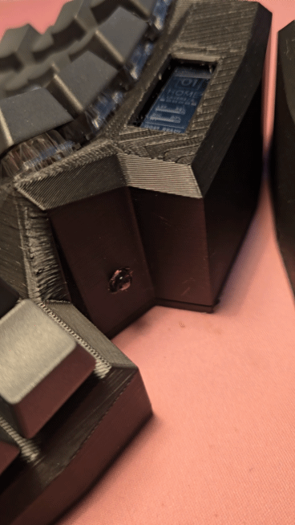
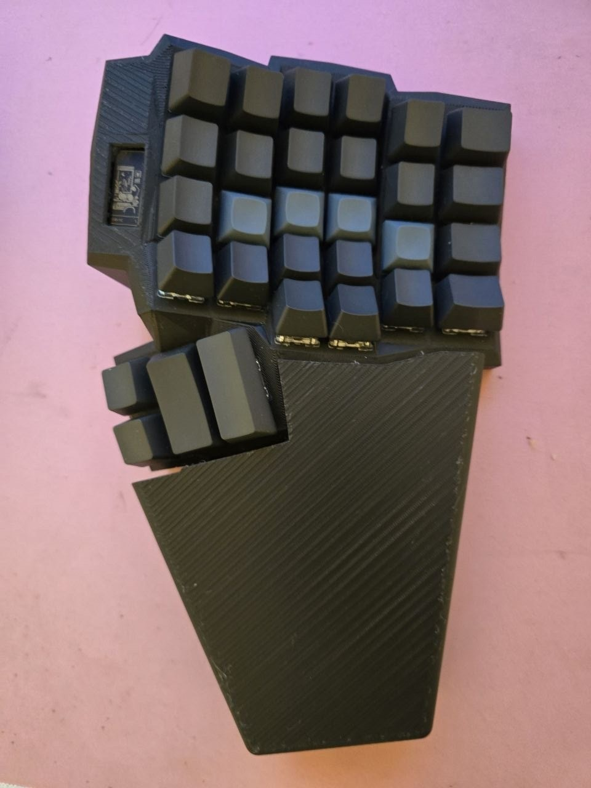
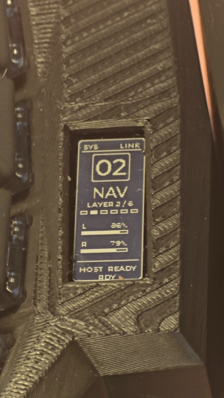

<!-- _class: visual -->

# Апаратна демонстрація

<figure class="shot">

<figcaption>LED</figcaption>
</figure>

<figure class="shot">

<figcaption>Половинка з підставкою під запʼястя</figcaption>
</figure>

<figure class="shot">

<figcaption>Стани і віджети екранів</figcaption>
</figure>

<b>Bluetooth</b> профілі, з'єднання половинок
<b>Клавіші / шари</b> home, nav, func, mouse, game
<b>Екрани</b> заряд, поточний профіль, лінк
<b>RGB / buzzer</b>, статус BLE, reset / bootloader mode

<h3>Що не видно на фото</h3>

TLV-канал і конфігуратор: розкладка змінюється у працюючій клавіатурі, без перепрошивки

