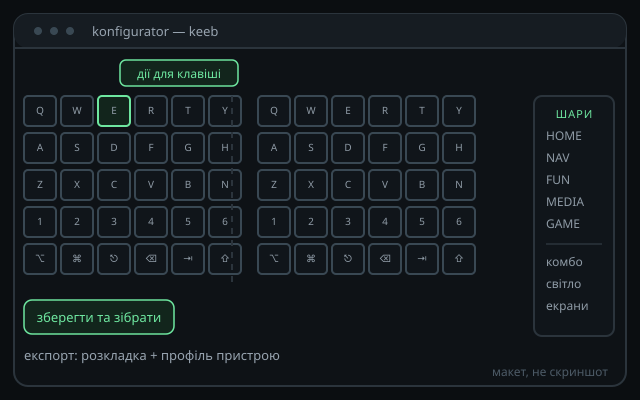

# Програмна демонстрація

<h3>Веб-конфігуратор</h3>

Клавіша → дія, шари, комбінації, home-row модифікатори — без редагування коду.

<h3>Логування</h3>

Конфігуратор видає розкладку й налаштування для збірки прошивки; поточний спосіб — розкладка у коді — лишається можливим.

