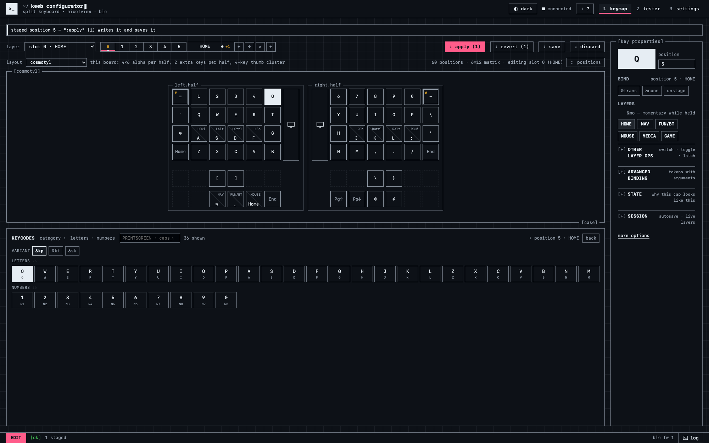

<!-- _class: visual -->

# Програмна демонстрація

<h2>Час Live demo!</h2>

Програмну частину — конфігуратор, шари, TLV-канал і застосування правок — демонструю <strong>на живій клавіатурі</strong>.

<figure class="shot">

</figure>

