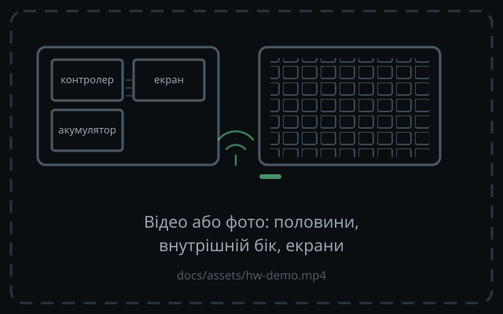

# Апаратна демонстрація

<h3>60 позицій, 12 колонків</h3>

4 алфа-ряди, ряд дужок і великовий ряд; широка прогалина — межа половинок.

<h3>Матриця 6×6 на половинку</h3>

30 активних позицій з 36 комірок: 12 ліній замість 30 дротів до контролера.

<h3>matrix-transform</h3>

Розкладка не залежить від проводки: HOME лишається чистим, а прототип і майбутні гнуті плати мають ту саму логіку.

