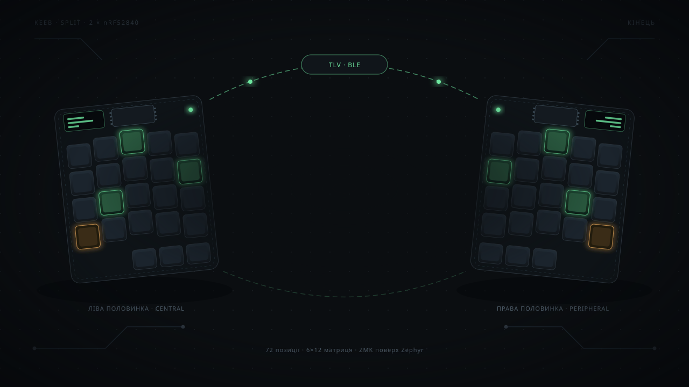

<!-- _class: closing -->

<!--
  Фінал деку. Art = docs/assets/thanks.svg: 1280×720, тобто точно розмір
  слайда 16:9, тому `![bg cover]` масштабує 1:1 і нічого не кропає.

  Композиція свідомо залишає середину порожньою: дві половинки — це малюнок,
  а проміжок між ними — радіоканал, і саме в ньому лежить текст (у SVG це
  band x 407..873). Текст тримаємо коротким саме тому: заголовок ~520px,
  підзаголовок в один рядок, два chips. Довший текст вилазить на клавіші.

  Слайд не додає власного затемнення (на кшталт `.hero::before`): темне
  радіальне п'ятно `#shade` уже намальоване в SVG під текстом, тож подвійний
  scrim лише давив би малюнок.

  Типографіка — у theme/keeb.css (`section.closing`): заголовок із градієнтом
  через `background-clip: text`, тому тінь робиться `filter: drop-shadow`,
  а не `text-shadow` (text-shadow малюється ПІД прозорим fill тексту).
-->

# Дякую за увагу

Буду радий відповісти на запитання.

<b>Репозиторій</b> <a href="https://github.com/yermakovm/keeb">github.com/yermakovm/keeb</a>

